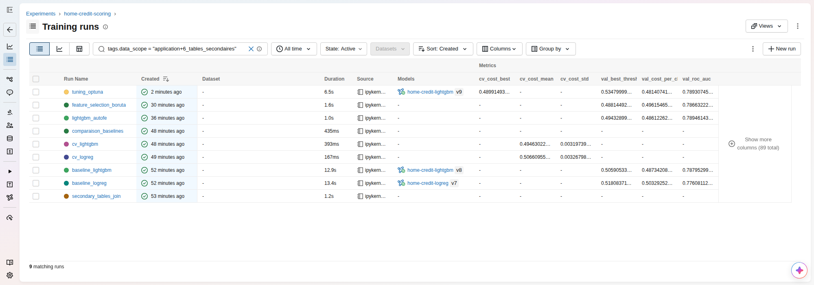

# P6 — Initiez-vous au MLOps (Partie 1) : scoring crédit Home Credit

Pipeline MLOps complet de bout en bout dans un seul notebook exécutable —
EDA → **agrégats & jointures des 6 tables secondaires** → préparation → baselines pondérées
(LogReg / LightGBM, `class_weight='balanced'`) → feature engineering automatisé
(OpenFE) → feature selection (BorutaShap) → tuning Optuna (coût métier FN = 10 × FP)
→ MLflow Model Registry → serving pyfunc → app Gradio d'inférence :

- Notebook : [`notebooks/p6_ml.ipynb`](notebooks/p6_ml.ipynb)
- Consulter le notebook exécuté sans le relancer (~53 min) :
  - export HTML statique (sorties et graphiques inclus) : [`docs/p6_ml.html`](docs/p6_ml.html) — à télécharger puis ouvrir dans un navigateur, ou [aperçu en ligne](https://html-preview.github.io/?url=https://github.com/WillIsback/P6_Initiez-vous_au_MLOps_Partie_1/blob/main/docs/p6_ml.html)
  - rendu via [nbviewer](https://nbviewer.org/github/WillIsback/P6_Initiez-vous_au_MLOps_Partie_1/blob/main/notebooks/p6_ml.ipynb)
- Documentation détaillée (choix + application, en français) : [`docs/`](docs/README.md)
- Captures de l'interface MLflow (runs, comparaison, run tuné, artefacts, registry, inférence) : [`docs/img/`](docs/img/)

## Résultats (validation, 61 503 demandes jamais vues à l'entraînement)

| Étape | Features | ROC-AUC | Coût métier / client |
|---|---|---|---|
| Tout refuser (référence sans modèle) | — | — | 0,807 |
| Baseline LightGBM | 221 | 0,788 | 0,487 |
| + OpenFE | 603 | 0,790 | 0,486 |
| + BorutaShap | 122 | 0,787 | 0,496 |
| **+ tuning Optuna (modèle servi)** | **122** | **0,789** | **0,481** |

Coût métier : FN = 10 × FP, seuil de décision optimisé sur le train (0,535 pour le modèle
pondéré). Les tables secondaires sont le levier principal : l'ancienne version (table
principale seule) plafonnait à AUC 0,766 / coût 0,522.



## Installation

```bash
git clone <ce-dépôt> && cd P6_Initiez-vous_au_MLOps_Partie_1
uv sync                 # Python 3.11 + toutes les dépendances (uv.lock figé)
```

Prérequis : [uv](https://docs.astral.sh/uv/), ~5 Go de RAM libres, aucun GPU.

## Données

Les données (~6 Go avec les sorties intermédiaires) ne sont **pas versionnées** : le notebook télécharge et
extrait lui-même le jeu Home Credit (table principale + 6 tables secondaires) au premier run (voir
[`data/README.md`](data/README.md) pour la reconstitution complète depuis un
clone vierge).

## Temps d'exécution du notebook

**~53 min au total** — mesuré sur un rejeu complet (exécution cellule par cellule
avec `nbclient`, du 02/11/2026), horodatages extraits des cellules.

Configuration de mesure (hôte de dev) : **AMD Ryzen 7 5700G, 8 cœurs / 16 threads,
30 Go RAM, Ubuntu 24.04 — aucun GPU**. Toute la parallélisation est bornée à
`n_jobs=8` (moitié des cœurs), conformément à la contrainte CPU du projet.

| Section | Contenu | Temps | Part |
|---|---|---:|---:|
| 1 → 5 | Setup, chargement des CSV, EDA | < 0,5 min | 1 % |
| 5bis | Tables secondaires : exploration, agrégats, jointure | 0,9 min | 2 % |
| 6 | Préparation des données (sentinelles, clip, imputation) | 0,7 min | 1 % |
| 7 → 8 | Entraînement & Model Registry (baselines) | 1,1 min | 2 % |
| 9 | Cross-validation 5-fold & comparaison | 3,2 min | 6 % |
| 10 | Feature engineering automatisé (OpenFE) | 12,5 min | 24 % |
| 11 | Feature selection — filtre variance + BorutaShap | 5,7 min | 11 % |
| 12 | Tuning Optuna (25 essais × 5-fold CV) | **28,2 min** | **54 %** |
| **Total** | | **~53 min** | **100 %** |

À savoir avant de lancer :
- **Le tuning Optuna domine le runtime (54 %)** — 25 essais × 5 fits avec
  early stopping sur les 122 features sélectionnées. OpenFE (~12 min) et
  BorutaShap (~6 min) sont les deux autres étapes gourmandes.
- C'est un pipeline **CPU-bound** : prévoir ~6 Go de RAM libres, ne pas
  lancer un autre travail lourd en parallèle, et compter ~1 h 15 pour un
  premier rejeu (téléchargement du zip de 720 Mo et extraction inclus).
- Le serveur MLflow doit être actif avant de démarrer (sinon les cellules
  d'enregistrement échouent) :

```bash
./scripts/serve_mlflow.sh                 # 1) serveur MLflow sur :5000
.venv/bin/jupyter lab notebooks/p6_ml.ipynb  # 2) Run All (~53 min)
```

Chronique indicative du coût de calcul par étape et dimensionnement de la VM de
déploiement : [`docs/00_environnement_et_dimensionnement.md`](docs/00_environnement_et_dimensionnement.md)
(règle DAT du projet).

## Phase inférence (après le notebook)

```bash
.venv/bin/python scripts/build_serving_model.py   # wrapper pyfunc -> Registry home-credit-serving
# le PATH doit privilégier uvicorn du venv (voir docs/07 — piège documenté) :
PATH="$PWD/.venv/bin:$PATH" .venv/bin/mlflow models serve \
    -m 'models:/home-credit-serving/2' -p 5001 --env-manager local   # version créée par le script ci-dessus
.venv/bin/python scripts/build_inference_db.py    # base SQLite des 48 744 clients de test (~30 s)
.venv/bin/python apps/gradio_app.py               # app Gradio sur :7860
```

- Serving du modèle (wrapper pyfunc encodeur + LightGBM + seuil) : [`docs/07_serving.md`](docs/07_serving.md)
- App Gradio + base SQLite d'inférence + traçage « Prod Inference » : [`docs/08_gradio_inference.md`](docs/08_gradio_inference.md)
